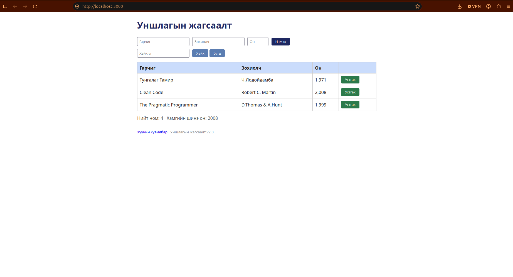

# BUG-01: Хүснэгтийн «Он» баганад он таслалтай (1,971) харагддаг

Орчин: Уншлагын жагсаалт v2.0, Firefox, Ubuntu 24.04, 2026-10-19

Урьдчилсан нөхцөл: node app.js-ийг шинээр асаасан (анхны 3 ном)

## Дахин гаргах алхам

1. Терминалд `node app.js` ажиллуулна
2. Браузераар http://localhost:3000 нээнэ
3. Хүснэгтийн «Он» баганыг харна

Хүлээгдэж байсан: «Он нь 1000-2100 хоорондох бүхэл тоо; хүснэгтэд энгийн тоогоор (жишээ нь 1999) харагдана.»

Бодит үр дүн: Бүх он мянгатын таслалтай харагдана: «1,971», «2,008», «1,999».

Ноцтой байдал: Minor — өгөгдөл зөв хадгалагдсан ч харагдах формат спецификациас зөрж, он мөнгөн дүн мэт уншигдана.

Хавсралт: 

Олдсон аялал: Supermodel (GUI)
